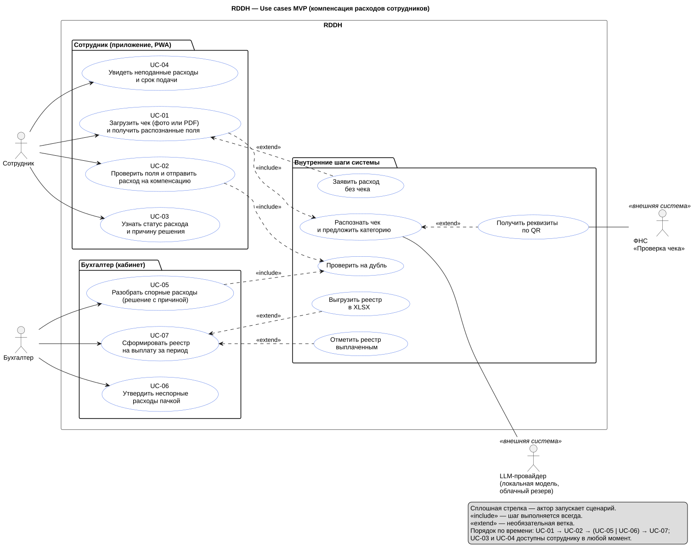

# Use cases RDDH

Use case (UC) — единственный артефакт, из которого выводится всё остальное: код, тесты, evals. Если поведение системы не описано в UC, его нет в MVP; если UC и код расходятся — прав UC, расхождение — дефект.

Диаграмма: [use-cases.puml](use-cases.puml) · картинка: [use-cases.svg](use-cases.svg).



## Список UC

| UC | Актор | Цель | Боль PRD | Экран прототипа |
| --- | --- | --- | --- | --- |
| [UC-01](uc-01-upload-receipt.md) | Сотрудник | Загрузить чек (фото или PDF) и получить распознанные поля | 1, 2, 3 | «Новый расход» |
| [UC-02](uc-02-review-and-submit.md) | Сотрудник | Проверить поля и отправить расход на компенсацию | 1, 3, 5 | «Проверьте поля» |
| [UC-03](uc-03-track-status.md) | Сотрудник | Узнать статус расхода и причину решения | 3, 5 | «Мои расходы», «Статус заявки» |
| [UC-04](uc-04-deadline-and-unsubmitted.md) | Сотрудник | Увидеть неподанные расходы и срок подачи | 4 | баннер периода на «Мои расходы» |
| [UC-05](uc-05-resolve-disputed.md) | Бухгалтер | Разобрать спорные расходы (решение с причиной) | 3, 5 | «Спорные расходы», карточка |
| [UC-06](uc-06-bulk-approve.md) | Бухгалтер | Утвердить неспорные расходы пачкой | 5 | **нет экрана** (Q6) |
| [UC-07](uc-07-build-registry.md) | Бухгалтер | Сформировать реестр на выплату за период | 5 | «Реестр на выплату» |

Акторы MVP — **сотрудник** и **бухгалтер**, как в C4 ([docs/architecture/README.md](../architecture/README.md)). Руководитель-согласующий и HR-администратор политики в MVP не моделируются: политика компенсации заводится командой как справочник (seed), учётные записи — тоже. Вход в систему не вынесен в UC: это предусловие.

Номера болей — по `docs/prd.md` (5 болей). В `docs/quality/success-criteria.md` боли пронумерованы иначе (6 болей, другие формулировки); в UC всюду ссылаемся на PRD, на метрики — по их ID (NS/SC/E/Q).

## Шаблон UC

Каждый UC — один файл `uc-NN-<slug>.md` с YAML-шапкой, чтобы его можно было разобрать скриптом.

```markdown
---
id: UC-NN
title: <глагол + объект>
actor: employee | accountant
secondary_actors: [...]
status: draft-v1 | accepted
pains: [номера болей PRD]
metrics: [ID из success-criteria.md]
golden: [номера примеров golden-dataset-plan.md]
containers: [контейнеры C4]
prototype: [экраны]
---
# UC-NN. <название>
| Актор | Цель | Контекст (где и когда) | Предусловия | Триггер | Результат (успех) | Результат (неуспех) |

## Основной сценарий      — таблица «№ | Кто | Что происходит»; в каждой строке один актор и одно действие
## Альтернативы и ошибки  — таблица «№ | Условие | Что происходит»
## Данные и статусы       — статусы, таблицы, контейнеры; то, что проверит Delivery
## Приёмочные сценарии    — Gherkin с ID UC-NN-ACn; метрики; golden-примеры
## Проживаемость          — чек-лист, ссылка на livability-test.md
```

Правила письма:

1. Шаг — одно действие одного актора. «Система» — только то, что человек видит или что меняет данные.
2. В шагах нет имён технологий и контейнеров: они живут в разделе «Данные и статусы».
3. Тексты экранов приводятся дословно в кавычках — их проверяют тесты.
4. Каждая альтернатива заканчивается состоянием: что видит человек и в каком статусе расход.
5. Нет «и т. д.», «при необходимости», «как обычно» без уточнения, кому и что именно.

## Как из UC выводится остальное

| Из UC | Выводим | Кто |
| --- | --- | --- |
| Основной сценарий и альтернативы | Эндпоинты `api`, статусная машина, экраны | Delivery |
| Приёмочные сценарии (`UC-NN-ACn`) | Автотесты (unit / integration / e2e); тег теста = ID сценария | Delivery, Quality |
| Метрики и golden-примеры | Evals на golden dataset; новые примеры привязываются к UC через `meta.us_id` | Quality, AI Engineer |
| Поля «к компенсации», «спорный», «причина» | Контракт `categorize()` и схема ответа модели | AI Engineer |
| Раздел «Данные и статусы» | Проверка схемы БД и C4 на соответствие | Delivery |

## Трассировка: UC → метрики → архитектура

| UC | Метрики | Контейнеры C4 | Статусы расхода |
| --- | --- | --- | --- |
| UC-01 | NS-01, SC-01…03, SC-05, E-01, E-03, E-04, Q-02 | employee_app, api, task_queue, recognition_worker, ocr_service, fns_adapter, llm_adapter, expense_store, receipt_files | draft → processing → recognized; no_receipt |
| UC-02 | NS-02, NS-05, SC-10…14 | employee_app, api, expense_store | recognized → submitted → in_review |
| UC-03 | SC-12, SC-19…21, NS-06 | employee_app, api, expense_store | все (чтение) |
| UC-04 | SC-08, SC-09 | employee_app, api, expense_store | draft, recognized (чтение) |
| UC-05 | NS-03, NS-04, SC-11…13, SC-18, SC-20 | backoffice_web, api, expense_store, receipt_files | in_review → approved \| rejected |
| UC-06 | NS-03, NS-04, SC-11, Q-01 | backoffice_web, api, expense_store | submitted → approved |
| UC-07 | NS-04, SC-16…20 | backoffice_web, api, expense_store | approved → in_registry → reimbursed |

## Допущения Product и вопросы к синхронизации

Эти пункты нашлись при сверке UC со схемой БД и прототипом Delivery и с критериями Quality. Они не блокируют UC, но их надо закрыть до Lab 3.

| № | Кому | Что расходится | Предложение Product |
| --- | --- | --- | --- |
| Q1 | Delivery | В схеме только `rejection_reason text`. PRD требует считать отказы по причине «нечитаемо / не хватает данных» (≤ 5%) | Добавить тип причины (`rejection_reason_code`: `policy`, `unreadable`, `missing_data`, `duplicate`, `other`) |
| Q2 | Delivery | У `registry_item` ключ `(registry_id, expense_id)`, а в прототипе один расход даёт две строки: «Спорт-Лайф 3 000 ₽» включён, «массаж 1 500 ₽» исключён | Строка реестра ссылается на позицию `expense_item`; либо расход делится на два |
| Q3 | Delivery | Уникальный индекс `expense_fiscal_uniq` не пускает второй расход с теми же ФН+ФД+ФП, даже если первый отклонён как «нечитаемо» | Индекс не должен учитывать `rejected` (UC-02, A4) |
| Q4 | Delivery | Нет ни периода, ни дедлайна подачи (UC-04); в прототипе «Октябрь 2026 · до 31.10» захардкожен | Настройка компании: длина периода и день дедлайна |
| Q5 | Delivery | В ADR-0001 «статус `degraded`», но в `expense_status` такого значения нет: есть флаг `recognition_run.degraded` и `needs_review` | Формулировка ADR-0001 поправлена при приёмке: это флаги, а не статусы. Сотруднику показываем «Проверьте поля» |
| Q6 | Delivery | В прототипе нет экрана массового утверждения (UC-06) и кнопки «Отметить выплаченным» (UC-07) | Добавить вкладку «К утверждению» и кнопку в реестр |
| Q7 | Delivery | `registry_status = approved` в MVP никто не использует: согласующего реестр нет | Не использовать; убрать из схемы или оставить как задел |
| Q8 | Quality | Срок решения: PRD — спорные ≤ 2 рабочих дня; NS-06 — медиана по всем ≤ 5 рабочих дней; прототип показывает «до 14.10» при отправке 07.10 (7 дней) | Два числа не противоречат: спорные ≤ 2, остальные ≤ 5. Сотруднику показываем «до <даты>» по этим двум срокам; прототип поправить |
| Q9 | Delivery | Удаление неподанного расхода (UC-02, A1): статуса «удалён» нет | Жёсткое удаление `draft` и `recognized`; каскад в схеме уже есть. После отправки удалять нельзя |

Допущения UC, не зависящие от других ролей: период подачи — отчётный месяц покупки; система сама не одобряет и не отклоняет; PWA без офлайн-режима; один пилотный `company_id`; тексты экранов взяты из прототипа.
